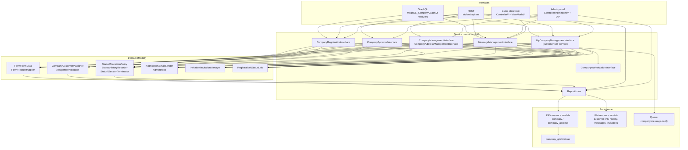
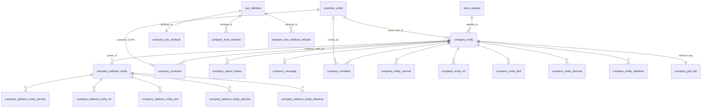
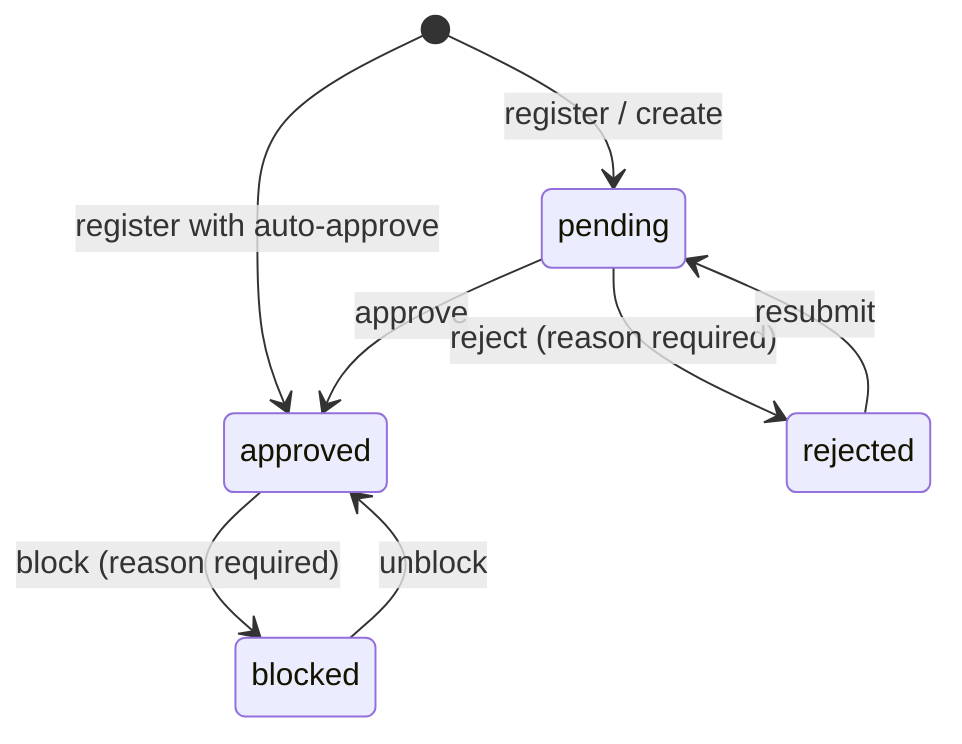
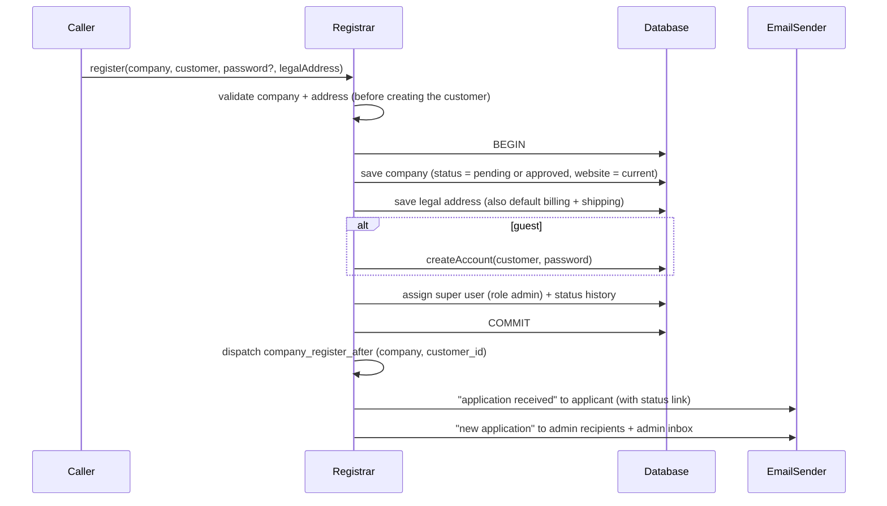

# MageOS Company: Technical Documentation

Architecture, data model and internal flows of `MageOS_Company` and `MageOS_CompanyGraphQl`. For the purpose of the modules see the [Overview](OVERVIEW.md); for the APIs see [openapi.yaml](openapi.yaml) and [GRAPHQL_API.md](GRAPHQL_API.md).

---

## Contents

1. [Modules and dependencies](#1-modules-and-dependencies)
2. [Architecture](#2-architecture)
3. [Service contracts](#3-service-contracts)
4. [Data model](#4-data-model)
5. [EAV attributes and forms](#5-eav-attributes-and-forms)
6. [Company lifecycle (state machine)](#6-company-lifecycle-state-machine)
7. [Registration](#7-registration)
8. [Company users, roles and authorization](#8-company-users-roles-and-authorization)
9. [Login restriction and session termination](#9-login-restriction-and-session-termination)
10. [Extension points](#10-extension-points)
11. [Invitations](#11-invitations)
12. [Messaging and notifications](#12-messaging-and-notifications)
13. [Applicant status link](#13-applicant-status-link)
14. [Admin panel](#14-admin-panel)
15. [Companies grid indexer](#15-companies-grid-indexer)
16. [Attribute management](#16-attribute-management)
17. [Web APIs](#17-web-apis)
18. [Emails](#18-emails)
19. [Configuration reference](#19-configuration-reference)
20. [Security model](#20-security-model)
21. [Installation, deployment and operations](#21-installation-deployment-and-operations)
22. [Testing](#22-testing)
23. [Code map](#23-code-map)

---

## 1. Modules and dependencies

| Module | Path | Depends on |
|---|---|---|
| `MageOS_Company` | `app/code/MageOS/Company` | `Magento_Store`, `Magento_Directory`, `Magento_Eav`, `Magento_Customer`, `Magento_Ui`, `Magento_Authorization`, `Magento_Integration`, `Magento_Email`, `Magento_User`, `Magento_AdminNotification`, `Magento_MessageQueue`, `Magento_ReCaptchaUi`, `Magento_ReCaptchaAdminUi`, `Magento_ReCaptchaFrontendUi`, `Magento_ReCaptchaWebapiApi`, `Magento_Webapi` |
| `MageOS_CompanyGraphQl` | `app/code/MageOS/CompanyGraphQl` | `MageOS_Company`, `Magento_GraphQl`, `Magento_CustomerGraphQl` |

Platform: Mage-OS 3+. Code uses PHP 8.1 syntax (`readonly` promoted properties, `match`, first-class enums are **not** used: statuses and roles are class constants, for compatibility with Magento's DI and serialization).

Coding standards: `declare(strict_types=1)` everywhere, strict types, PHPCS `Magento2`, PHPStan level 6, service contracts only across module boundaries, no direct `ObjectManager`, no model `save()`/`load()` outside repositories and resource models, all template output escaped, all storefront POSTs with form key.

---

## 2. Architecture



Principles:

- **One rule, one place.** Controllers, REST and GraphQL resolvers are thin adapters. Validation, authorization and side effects (history, emails, session termination) live in the services, so every interface behaves identically.
- **Company from identity, never from input.** Customer-facing services receive the customer ID (from the session, the REST token via `%customer_id%`, or the GraphQL context) and derive the company with `Model\Authorization\CompanyContext`.
- **Form-scoped payloads.** Customer-facing writes only accept the attributes of the corresponding form code (`Model\Form\FormData`, `Model\Form\RequestApplier`). Protected fields cannot be mass-assigned.
- **Platform patterns.** EAV entities modelled on `customer`/`customer_address`; UI components; the customer grid indexer framework; Magento message queue; ACL; reCAPTCHA framework.

---

## 3. Service contracts

All interfaces are in `MageOS\Company\Api` and marked `@api`.

### 3.1 Data interfaces (`Api/Data`)

| Interface | Implementation | Notes |
|---|---|---|
| `CompanyInterface` | `Model\Company` | Extends `CustomAttributesDataInterface`. Static fields + EAV values as custom attributes. Status constants `STATUS_PENDING=0`, `STATUS_APPROVED=1`, `STATUS_REJECTED=2`, `STATUS_BLOCKED=3`. |
| `CompanyAddressInterface` | `Model\CompanyAddress` | Extends `CustomAttributesDataInterface`. Fields mirror `customer_address`. |
| `CompanyCustomerInterface` | `Model\CompanyCustomer` | Link customer ↔ company: role (`admin`/`user`), job title, status (`1` active, `0` inactive). Also the `company_attributes` extension attribute of `CustomerInterface` (read-only). |
| `StatusHistoryInterface` | `Model\StatusHistory` | Actor types `admin`, `customer`, `system`, `integration`. |
| `MessageInterface` | `Model\Message` | Author types `admin`, `customer`, `system`. |
| `CompanySearchResultsInterface`, `CompanyAddressSearchResultsInterface`, `MessageSearchResultsInterface` | `Model\*SearchResults` | |

### 3.2 Service interfaces (`Api`)

| Interface | Implementation | Methods |
|---|---|---|
| `CompanyRepositoryInterface` | `Model\CompanyRepository` | `save`, `getById`, `getByErpCode`, `getList`, `delete`, `deleteById` |
| `CompanyAddressRepositoryInterface` | `Model\CompanyAddressRepository` | `save`, `getById`, `getList`, `delete`, `deleteById` |
| `CompanyManagementInterface` | `Model\CompanyManagement` (writes delegated to `Model\Management\CompanyWriter`, registration to `Model\Registration\Registrar`) | `register(company, customer, ?password, ?legalAddress)`, `create`, `update(companyId, company)`, `setErpCode`, `getByCustomerId`, `assignCustomer(companyId, customerId, role, ?jobTitle)`, `unassignCustomer`, `setCustomerStatus`, `getCustomers`, `setSuperUser` |
| `CompanyAddressManagementInterface` | `Model\CompanyAddressManagement` | `getList(companyId)`, `get(companyId, addressId)`, `save(companyId, address)`, `delete(companyId, addressId)`: every call checks that the address belongs to the company |
| `CompanyApprovalInterface` | `Model\CompanyApproval` | `approve(id, ?comment)`, `reject(id, reason)`, `block(id, reason)`, `unblock(id, ?comment)`, `resubmit(id, ?comment)`, `getHistory(id)` |
| `CompanyRegistrationInterface` | `Model\Registration\CompanyRegistration` | `apply(company, customer, password, legalAddress)`: public registration used by REST and GraphQL |
| `MyCompanyManagementInterface` | `Model\MyCompanyManagement` | Self-service for a company user: `get`, `update`, `getAddresses`, `getAddress`, `saveAddress`, `deleteAddress`, `setDefaultAddress(customerId, addressId, type)`, `getUsers`, `inviteUser`, `updateUser`, `removeUser`, `getMessages`, `sendMessage`, `markMessagesRead` |
| `MessageRepositoryInterface` | `Model\MessageRepository` | `save`, `getById`, `getList` |
| `MessageManagementInterface` | `Model\MessageManagement` | `send(companyId, body, authorType, ?authorId, isInternal)`, `sendAsAdmin(companyId, body, isInternal)`, `sendAsApplicant(companyId, body)`, `getThread(companyId, includeInternal)`, `markRead(companyId, readerType)`, `getUnreadCount(companyId, readerType)` |
| `CompanyAuthorizationInterface` | `Model\Authorization\RoleBasedAuthorization` | `isAllowed(customerId, resource)` |

**Repository semantics.**

- `CompanyRepository::save()` saves the company and, in the same transaction, assigns the super user as `admin`.
- A detached payload (with an ID, not loaded by the repository, e.g. from REST) is **merged** onto the stored entity; `null` fields are left untouched.
- `Model\CompanyRegistry` caches loaded companies per request; deleting an address invalidates the cached company.
- The repository does **not** record status history: that is done by whoever creates or changes the status (registration, admin creation, `CompanyApproval`).

**Write semantics of `CompanyManagementInterface::update()`** (admin/integration): omitted or `null` fields are not changed, `""` clears a value. `status` (use the approval methods), `company_id` (use `setErpCode`, ACL `company_erp`) and `website_id` are ignored. `create()` starts the company as `pending`, records history, sets no ERP code, and uses the default store's website when none is given.

---

## 4. Data model

### 4.1 Entity–relationship diagram



`company_entity.default_billing`, `default_shipping` and `legal_address` reference `company_address_entity.entity_id` **without** foreign keys (as in `customer_entity`), to avoid circular FKs. `ResourceModel\CompanyAddress::_afterDelete()` clears them when the address is deleted.

The tables have no vendor prefix (`company_*`). They therefore collide with Adobe Commerce B2B (`Magento_Company`); both cannot be installed together.

### 4.2 Tables

Declared in `etc/db_schema.xml` (with `db_schema_whitelist.json`). 19 tables, plus the indexer tables `company_grid_flat` and `company_grid_cl`.

#### `company_entity`: company (static attributes)

| Column | Type | Null | Default | Notes |
|---|---|---|---|---|
| `entity_id` | int unsigned, identity | no | | PK |
| `name` | varchar(255) | no | | Index |
| `company_id` | varchar(64) | yes | | External (ERP) code. **Unique globally** (`COMPANY_ENTITY_COMPANY_ID`) |
| `status` | smallint unsigned | no | 0 | 0 pending, 1 approved, 2 rejected, 3 blocked. Index |
| `email` | varchar(255) | no | | Unique with `website_id` (`COMPANY_ENTITY_EMAIL_WEBSITE_ID`) |
| `website_id` | smallint unsigned | no | | FK `store_website.website_id` (no action). Index |
| `super_user_id` | int unsigned | yes | | FK `customer_entity.entity_id` ON DELETE SET NULL. Index |
| `default_billing` | int unsigned | yes | | Address ID (no FK) |
| `default_shipping` | int unsigned | yes | | Address ID (no FK) |
| `legal_address` | int unsigned | yes | | Address ID (no FK) |
| `created_at` | timestamp | no | CURRENT_TIMESTAMP | |
| `updated_at` | timestamp | no | CURRENT_TIMESTAMP | ON UPDATE |

#### `company_entity_{datetime,decimal,int,text,varchar}`: company EAV values

Same structure as `customer_entity_*` (no `store_id`):

| Column | Type | Notes |
|---|---|---|
| `value_id` | int, identity | PK |
| `attribute_id` | smallint unsigned | FK `eav_attribute` CASCADE. Index |
| `entity_id` | int unsigned | FK `company_entity` CASCADE |
| `value` | datetime / decimal(12,4) / int / text / varchar(255) | |

Unique key (`entity_id`, `attribute_id`); index (`entity_id`, `attribute_id`, `value`) except on `text`.

#### `company_address_entity`: company address (static attributes)

| Column | Type | Null | Default | Notes |
|---|---|---|---|---|
| `entity_id` | int unsigned, identity | no | | PK |
| `parent_id` | int unsigned | no | | FK `company_entity.entity_id` ON DELETE CASCADE. Index |
| `is_active` | smallint unsigned | no | 1 | |
| `firstname` | varchar(255) | no | | |
| `lastname` | varchar(255) | no | | |
| `company` | varchar(255) | yes | | |
| `street` | text | no | | Lines separated by `\n` |
| `city` | varchar(255) | no | | |
| `country_id` | varchar(255) | no | | ISO-2 code |
| `region` | varchar(255) | yes | | Filled from `region_id` on save |
| `region_id` | int unsigned | yes | | `directory_country_region` ID |
| `postcode` | varchar(255) | yes | | |
| `telephone` | varchar(255) | no | | |
| `vat_id` | varchar(255) | yes | | |
| `created_at`, `updated_at` | timestamp | no | CURRENT_TIMESTAMP | `updated_at` ON UPDATE |

#### `company_address_entity_{datetime,decimal,int,text,varchar}`

Same structure as the company value tables, with FK to `company_address_entity`.

#### `company_eav_attribute`: additional attribute metadata

Shared by both entity types (as `customer_eav_attribute` is shared by customer and customer address).

| Column | Type | Default | Notes |
|---|---|---|---|
| `attribute_id` | smallint unsigned | | PK, FK `eav_attribute` CASCADE |
| `is_visible` | smallint unsigned | 1 | |
| `input_filter` | varchar(255) | null | |
| `multiline_count` | smallint unsigned | 1 | |
| `validate_rules` | text | null | JSON, e.g. `{"max_text_length":255,"min_text_length":1}`, `{"input_validation":"email"}` |
| `is_system` | smallint unsigned | 0 | System attributes are protected in the attribute admin |
| `sort_order` | int unsigned | 0 | Index |
| `data_model` | varchar(255) | null | |
| `is_used_in_grid` | smallint unsigned | 0 | Column in `company_grid_flat` |
| `is_visible_in_grid` | smallint unsigned | 0 | Visible by default |
| `is_filterable_in_grid` | smallint unsigned | 0 | B-tree index + grid filter |
| `is_searchable_in_grid` | smallint unsigned | 0 | Fulltext index + keyword search |

#### `company_form_attribute`

| Column | Type | Notes |
|---|---|---|
| `form_code` | varchar(32) | PK part |
| `attribute_id` | smallint unsigned | PK part, FK `eav_attribute` CASCADE |

#### `company_eav_attribute_website`

Per-website overrides required by the base EAV layer: `attribute_id` + `website_id` (PK, both FK CASCADE), `is_visible`, `is_required`, `default_value` (text), `multiline_count`.

#### `company_customer`: customer ↔ company

| Column | Type | Null | Default | Notes |
|---|---|---|---|---|
| `customer_id` | int unsigned | no | | **PK** (one company per customer). FK `customer_entity` CASCADE |
| `company_entity_id` | int unsigned | no | | FK `company_entity` CASCADE. Index (`company_entity_id`, `role`) |
| `role` | varchar(32) | no | `user` | `admin` / `user` |
| `job_title` | varchar(255) | yes | | |
| `status` | smallint unsigned | no | 1 | 1 active, 0 inactive |
| `pending_welcome_email` | varchar(32) | yes | | Customer account email type held back until approval (see 7.3) |
| `created_at` | timestamp | no | CURRENT_TIMESTAMP | |

#### `company_status_history`

| Column | Type | Null | Notes |
|---|---|---|---|
| `history_id` | int unsigned, identity | no | PK |
| `company_entity_id` | int unsigned | no | FK `company_entity` CASCADE. Index |
| `from_status` | smallint unsigned | yes | Null on creation |
| `to_status` | smallint unsigned | no | |
| `comment` | text | yes | Reason or comment |
| `actor_type` | varchar(32) | no | `admin`, `customer`, `system`, `integration` |
| `actor_id` | int unsigned | yes | Admin user ID or customer ID |
| `created_at` | timestamp | no | |

#### `company_message`

| Column | Type | Null | Default | Notes |
|---|---|---|---|---|
| `message_id` | int unsigned, identity | no | | PK |
| `company_entity_id` | int unsigned | no | | FK `company_entity` CASCADE. Index (`company_entity_id`, `created_at`) |
| `author_type` | varchar(32) | no | | `admin`, `customer`, `system` |
| `author_id` | int unsigned | yes | | Admin user ID or customer ID; null for integrations and system |
| `body` | text | no | | Plain text |
| `is_internal` | smallint unsigned | no | 0 | Internal note (admin only) |
| `read_at_admin` | timestamp | yes | | Null = unread by the store |
| `read_at_customer` | timestamp | yes | | Null = unread by the company |
| `created_at` | timestamp | no | CURRENT_TIMESTAMP | |

A message is created already read by its own side. Internal notes count as read by the company and `system` messages as read by the store, so "unread" is always "read column is null".

#### `company_invitation`

| Column | Type | Null | Notes |
|---|---|---|---|
| `invitation_id` | int unsigned, identity | no | PK |
| `company_entity_id` | int unsigned | no | FK `company_entity` CASCADE. Index (`company_entity_id`, `email`) |
| `email` | varchar(255) | no | |
| `role` | varchar(32) | no | Default `user` |
| `job_title` | varchar(255) | yes | |
| `token_hash` | varchar(64) | no | SHA-256 of the token. Unique |
| `invited_by` | int unsigned | yes | FK `customer_entity` SET NULL |
| `expires_at` | timestamp | no | |
| `accepted_at` | timestamp | yes | |
| `created_at` | timestamp | no | |

#### `company_grid_flat` / `company_grid_cl`

Built by the `company_grid` indexer (section 15). `company_grid_flat` has `entity_id`, the static fields `name`, `email`, `company_id`, `status`, `website_id`, `super_user_id`, `created_at`, `updated_at`, and one column per attribute with `is_used_in_grid = 1`. `company_grid_cl` is the mview changelog.

### 4.3 EAV entity types

Registered by `Setup\Patch\Data\InstallCompanyEntities` through `Setup\CompanySetup`:

| Entity type | Entity table | Additional attribute table | Mirrors |
|---|---|---|---|
| `company` | `company_entity` | `company_eav_attribute` | `customer` |
| `company_address` | `company_address_entity` | `company_eav_attribute` | `customer_address` |

Both have a default attribute set and group, an entity model, `Model\Attribute` as attribute model and `ResourceModel\Attribute\Collection` / `ResourceModel\CompanyAddress\Attribute\Collection` as attribute collections. The resource models extend `Magento\Eav\Model\Entity\VersionControl\AbstractEntity`, the collections `...\VersionControl\AbstractCollection` (with a snapshot virtual type `MageOSCompanyEavSnapshot`).

`Model\EavCustomAttributesTrait` exposes non-static EAV values as custom attributes and keeps them in sync with the flat data used by the resource model.

---

## 5. EAV attributes and forms

### 5.1 Form codes (`Setup\CompanySetup`)

| Constant | Code | Entity | Used by |
|---|---|---|---|
| `FORM_COMPANY_REGISTER` | `company_register` | company | Registration form, REST `register`, GraphQL `createCompanyApplication` |
| `FORM_COMPANY_ACCOUNT_EDIT` | `company_account_edit` | company | My Company edit, REST `PUT /mine`, GraphQL `updateCompany` |
| `FORM_ADMIN_COMPANY` | `adminhtml_company` | company | Admin company form |
| `FORM_ADDRESS_REGISTER` | `company_address_register` | company_address | Legal address in registration |
| `FORM_ADDRESS_EDIT` | `company_address_edit` | company_address | Storefront address book, REST/GraphQL "mine" addresses |
| `FORM_ADMIN_ADDRESS` | `adminhtml_company_address` | company_address | Admin address modal |

### 5.2 System attributes: `company`

| Code | Backend | Input | Required | Forms | Validation |
|---|---|---|:---:|---|---|
| `name` | static | text | ✔ | register, account edit, admin | length 1–255 |
| `email` | static | text | ✔ | register, account edit, admin | email |
| `company_id` | static | text | | admin | max 64 (ERP code) |
| `status` | static | select | | admin | source `Model\Company\Attribute\Source\Status` |
| `website_id` | static | select | ✔ | admin | |
| `super_user_id`, `default_billing`, `default_shipping`, `legal_address` | static | text (hidden) | | | |
| `legal_name` | varchar | text | ✔ | register, account edit, admin | length 1–255 |
| `vat_id` | varchar | text | ✔ | register, account edit, admin | length 4–32 + configurable format check |
| `phone` | varchar | text | ✔ | register, account edit, admin | length 1–255 |
| `fax` | varchar | text | | register, account edit, admin | max 255 |
| `website_url` | varchar | text | | register, account edit, admin | url, max 255 |
| `industry` | int | select | | register, account edit, admin | options (Table source): Agriculture, Construction, Education, Energy, Finance, Healthcare, Hospitality, Information Technology, Manufacturing, Professional Services, Public Sector, Retail, Transportation & Logistics, Wholesale, Other |
| `employees_range` | int | select | | register, account edit, admin | options: 1-10, 11-50, 51-200, 201-500, 500+ |
| `description` | text | textarea | | register, account edit, admin | |
| `registration_comment` | text | textarea | | register, admin | |
| `preferred_language` | varchar | select | | register, account edit, admin | source `Model\Company\Attribute\Source\Locale` |

Grid defaults: `name`, `email`, `company_id`, `legal_name`, `vat_id`, `phone` are used, visible, filterable and searchable; `status`, `website_id` used/visible/filterable; `industry` used and filterable.

### 5.3 System attributes: `company_address`

All in the three address forms. Codes mirror `customer_address` to ease a future checkout integration.

| Code | Backend | Input | Required | Validation |
|---|---|---|:---:|---|
| `label` | varchar | text | | max 255 ("Headquarters", "Warehouse 2"…) |
| `firstname`, `lastname` | static | text | ✔ | length 1–255 |
| `company` | static | text | | max 255 |
| `street` | static | multiline (2 lines) | ✔ | length 1–255 per line |
| `city` | static | text | ✔ | length 1–255 |
| `country_id` | static | select | ✔ | source `Model\CompanyAddress\Attribute\Source\Country` |
| `region` / `region_id` | static | text / hidden | per country | `Magento\Directory` rules |
| `postcode` | static | text | per country | |
| `telephone` | static | text | ✔ | length 1–255 |
| `vat_id` | static | text | | max 255 |

`Setup\Patch\Data\UseCompanyCountrySource` replaces the customer country source: the core one extends `Table` and its `getOptionText()` looks up EAV option IDs instead of ISO codes, which broke EAV validation.

### 5.4 Reading and writing form data

- `Model\Form` (extends `Magento\Eav\Model\Form`) validates required fields and each attribute's rules.
- `Model\Form\RequestApplier` extracts a form's attributes from an HTTP request, validates them and applies them with `setData` (not `compactData()`, which would pass strings to typed setters). A posted empty value clears the field.
- `Model\Form\FormData` does the same for service payloads (REST/GraphQL): it copies only the form's attributes from the incoming data object and validates.
- `Model\Form\AttributeMetadataProvider` returns attribute metadata per form code (labels for the current store, options including Yes/No for booleans, validation rules). Used by GraphQL `companyAttributesMetadata`.
- Admin: `Ui\DataProvider\Form\AttributeMetaProvider` builds UI form metadata from the admin form codes; validation rules come from `EavValidationRules`.
- Storefront: `ViewModel\AttributeFields` builds field definitions; `templates/register/field.phtml` and `templates/form/country-region.phtml` render them (country/region with `regionUpdater`).

---

## 6. Company lifecycle (state machine)



- Rules in `Model\Status\TransitionPolicy` (allowed transitions, required reasons, labels). `approve` is only valid from `pending` and `unblock` only from `blocked`, although both lead to `approved`.
- Executed by `Model\CompanyApproval`. An invalid transition throws `LocalizedException` ("The company status cannot change from "%1" to "%2"."); a missing reason throws "A reason is required to set the status "%1".".
- `Model\Status\ActionRunner` maps admin actions (`approve`, `reject`, `block`, `unblock`, `resubmit`) to the service, for the admin buttons and mass actions.

Each transition:

1. Saves the new status and a `company_status_history` row **in one transaction**. The actor comes from `Model\Status\HistoryRecorder`, which resolves `UserContextInterface` (admin, integration, customer or system). `Model\Status\ActorResolver::actAs()` can override it (used by the applicant status link, so a resubmission is recorded as `customer:<super user>`).
2. Adds a `system` message with the new status and the reason to the thread (not notified).
3. Dispatches `company_status_change_after` (`company`, `from_status`, `to_status`, `comment`).
4. On `rejected`/`blocked`, ends the sessions and tokens of all company users (`Model\Status\SessionTerminator`).
5. Sends the email of the transition (`Model\Notification\EmailSender`). On approval, sends the held-back account confirmation email if any (7.3).

Email failures are logged and never roll back the transition.

---

## 7. Registration

### 7.1 Entry points

| Entry point | Implementation |
|---|---|
| Storefront form `company/register` → `company/register/post` | `Controller\Register\Post` → `CompanyManagementInterface::register()` |
| REST `POST /V1/companies/register` | `CompanyRegistrationInterface::apply()` |
| GraphQL `createCompanyApplication` | `CompanyRegistrationInterface::apply()` |

`CompanyRegistration::apply()` copies only the attributes of `company_register` and `company_address_register` from the payload, ignores the customer's ID, group and website (the customer is always new), and calls the registrar. If the customer email already exists, it answers with a generic error; a duplicated company email is reported (corporate data, not personal).

### 7.2 Transaction (`Model\Registration\Registrar`)



- Status, ERP code, website and default addresses are never taken from the input.
- Validation runs before the customer is created, so an error (e.g. duplicated company email) leaves neither a customer nor emails.
- A logged-in customer without a company registers without account fields; if the company stays `pending`, the session is closed.
- Terms acceptance (optional) and reCAPTCHA (`recaptcha_frontend/type_for/company_register`): `Observer\ValidateRegistrationCaptcha` on `controller_action_predispatch_company_register_post` for the form; `Model\Registration\WebapiCaptchaConfigProvider` for REST and GraphQL.
- The success page receives the result in the URL (`?approved=0|1`) only to choose the text: the session may already be closed.

### 7.3 One email for the applicant

`Model\Registration\WelcomeEmailDeferral` together with the `aroundNewAccount` plugin on `Magento\Customer\Model\EmailNotificationInterface` (`Plugin\Customer\EmailNotificationPlugin`) control Magento's account emails for customers created by the registration:

- The "welcome" email is never sent; the "company approved" email replaces it (also with auto-approval).
- The "confirmation" email (when the store requires confirmation) carries the activation link, so its type is stored in `company_customer.pending_welcome_email` and sent when the company is approved.
- While pending, the applicant receives only "application received". Notifications go to the super user, not to the corporate email.

---

## 8. Company users, roles and authorization

### 8.1 Assignment invariants

`Model\CompanyCustomer\Assigner` (with `AssignmentValidator`) enforces:

- A customer belongs to at most one company (`company_customer.customer_id` is the PK).
- The customer's website must match the company's website, unless customer accounts are shared globally (`customer/account_share/scope`).
- The super user is always an active `admin`.
- At least one active `admin` remains: the last admin cannot be demoted, deactivated or unassigned.
- Deactivating a user ends their sessions and tokens (`SessionTerminator::terminateCustomer()`).

### 8.2 Company context

`Model\Authorization\CompanyContext` resolves, for a customer ID, the company, the role and whether the user is active. The company always comes from the customer, never from request input.

### 8.3 Authorization

`CompanyAuthorizationInterface::isAllowed(int $customerId, string $resource): bool`. Resources (constants on the interface):

| Resource | Meaning |
|---|---|
| `company.view` | View the company profile |
| `company.edit` | Edit the company profile |
| `company.users.manage` | Manage users and invitations |
| `company.address.view` | View addresses |
| `company.address.manage` | Add, edit, delete addresses, set defaults |
| `company.messages.view` | Read the thread |
| `company.messages.send` | Send messages |

Default implementation `Model\Authorization\RoleBasedAuthorization`:

- no approved company or inactive user → nothing allowed;
- `admin` → everything;
- `user` → `company.view`, `company.address.view`, `company.messages.view`, `company.messages.send`.

Every consumer asks the interface, never the role: storefront controllers (`Controller\AbstractCompanyAction::RESOURCE`), account navigation links (`Block\Account\CompanyLink`), `MyCompanyManagement` (REST/GraphQL), and GraphQL `Company.allowed_resources`.

### 8.4 Customer extension attribute

`CustomerInterface` gets the extension attribute `company_attributes` (`CompanyCustomerInterface`), loaded by `Plugin\Customer\CustomerRepositoryPlugin` on `get`, `getById` and `getList`. It is **read-only**: it is not persisted from `CustomerRepositoryInterface::save()`, so a customer cannot join a company by editing their own account.

---

## 9. Login restriction and session termination

`Plugin\Customer\AccountManagementPlugin::afterAuthenticate()` on `Magento\Customer\Api\AccountManagementInterface`:

- If the customer belongs to a company that is not `approved`, or the user is inactive, it throws a `LocalizedException` with a message per status.
- It is a `LocalizedException`, not `UserLockedException`: the storefront `LoginPost` shows `LocalizedException` messages but hides `AuthenticationException` ones. REST and GraphQL token endpoints return their generic authentication error.
- The message only appears after a correct password, so it reveals nothing without credentials.
- "Login as Customer" does not go through `authenticate()` and keeps working for support.

`Model\Status\SessionTerminator` revokes API tokens (`CustomerTokenServiceInterface`) and storefront sessions (`SessionCleanerInterface`) of all users of a company (on reject and block) or of one user (on deactivation). A closed session raises the core `SessionException` on next use, like when an admin changes a customer's password.

---

## 10. Extension points

| Extension point | How |
|---|---|
| Granular permissions | Replace the `CompanyAuthorizationInterface` preference. All interfaces already ask it per resource. |
| Business logic on registration | Observe `company_register_after` (`company`, `customer_id`). |
| Business logic on status changes (ERP sync, CRM, …) | Observe `company_status_change_after` (`company`, `from_status`, `to_status`, `comment`). |
| Message integrations | Observe `company_message_send_after` (`message`, `company`), or add a consumer on topic `company.message.notify`. |
| Model events | Standard model events with prefixes `company`, `company_address`, `company_customer`, `company_message`, `company_status_history`, `company_invitation`, `company_entity_attribute` (`*_save_after`, `*_delete_after`, `*_save_commit_after`, …). |
| New fields | Add attributes in `Stores > Attributes > Company` or in a data patch (`Setup\CompanySetup`). They appear in forms, REST (custom attributes) and GraphQL (`custom_attributes`). |
| Emails | Override templates in the theme or select custom templates in configuration. |
| Storefront theme | Logic is in ViewModels (`ViewModel\*`); templates are thin, ready for a Hyvä module. |
| Services | All `Api` interfaces are DI preferences and can be decorated with plugins. |

Events dispatched by the module:

| Event | Data | Dispatched by |
|---|---|---|
| `company_register_after` | `company`, `customer_id` | `Model\Registration\Registrar` |
| `company_status_change_after` | `company`, `from_status`, `to_status`, `comment` | `Model\CompanyApproval` |
| `company_message_send_after` | `message`, `company` | `Model\MessageManagement` |

Events observed:

| Event | Observer |
|---|---|
| `company_save_commit_after`, `company_delete_commit_after` | `Observer\Grid\ReindexCompany` (reindex row when the indexer is "Update on Save") |
| `company_entity_attribute_save_after`, `company_entity_attribute_delete_after` | `Observer\Grid\InvalidateOnAttributeChange` |
| `controller_action_predispatch_company_register_post` (frontend) | `Observer\ValidateRegistrationCaptcha` |

Plugins:

| Subject | Plugin | Purpose |
|---|---|---|
| `Magento\Customer\Api\AccountManagementInterface` | `Plugin\Customer\AccountManagementPlugin` | Login restriction |
| `Magento\Customer\Model\EmailNotificationInterface` | `Plugin\Customer\EmailNotificationPlugin` | Welcome/confirmation email deferral |
| `Magento\Customer\Api\CustomerRepositoryInterface` | `Plugin\Customer\CustomerRepositoryPlugin` | `company_attributes` extension attribute |

---

## 11. Invitations

`Model\Invitation\InvitationManager`, table `company_invitation`, email template `company_email_invitation_template`.

- Every invitation must be accepted through the link, even for existing customers (no direct assignment from the storefront), so nobody joins a company without consent.
- Token: 48 random characters; only its SHA-256 is stored. Validity `company/users/invitation_lifetime` (7 days); expiry evaluated with the database clock.
- Inviting the same email again replaces the open invitation. Members of the own company cannot be invited; members of another company are refused with a generic message.
- `company/invitation/accept?token=…` (public) works only on the company's website and while the company is approved:
  - no account → creates one with the invited email (not editable), joins and logs in (unless confirmation is required);
  - existing account → must sign in (login with referer back);
  - logged in as another account → asked to sign out;
  - only the owner of the invited email can accept.
- `POST /V1/companies/mine/customers` and GraphQL `inviteCompanyUser` create invitations too.

Admin assignment (`Customers > Companies > Users > Assign Customer`, REST `POST /V1/companies/:companyId/customers`) assigns directly.

---

## 12. Messaging and notifications

`Model\MessageManagement`:

- One thread per company. Bodies are plain text: line breaks normalised and trimmed; HTML is escaped at render time.
- Only the store writes internal notes; they are never shown or notified to the company.
- A customer writes only in their own company, when it is approved and they are an active user. `sendAsApplicant()` (not in the web API) lets the applicant of a `pending`/`rejected` company reply from the status link, writing as the super user.
- Limits: `company/messages/max_length` (2000, not applied to `system` messages) and `company/messages/rate_limit` per customer per hour (20); 0 disables either.
- `sendAsAdmin()` takes the author from the context: an admin user keeps its ID; an integration writes as admin without ID (shown as "Integration").
- After saving, dispatches `company_message_send_after` and, except for internal notes and `system` messages, publishes the message ID to `company.message.notify`.

Queue (`etc/communication.xml`, `queue_publisher.xml`, `queue_topology.xml`, `queue_consumer.xml`):

| Item | Value |
|---|---|
| Topic | `company.message.notify` (async, request type `string`: the message ID) |
| Queue / consumer | `company.message.notify`, handler `Model\Message\NotifyConsumer` |
| Connection | default (MySQL queue unless AMQP is configured) |

`NotifyConsumer`:

- store → company: email (`new_message_customer`) to all active users, or to the company email if none. While pending/rejected, the email goes to the applicant with the status link instead of the thread link.
- company → store: email (`new_message_admin`) to `company/email/admin_recipients` and an admin inbox notice (`Model\Notification\AdminInbox`).

`Model\Notification\AdminUrl` builds admin links from any area, including CLI consumers (`FrontNameResolver::getFrontName(true)` returns empty in CLI because it compares the request host).

---

## 13. Applicant status link

`Model\Registration\StatusLink`:

- Token: `<company id>.<expiry unix timestamp>.<HMAC-SHA256>`. The key is the current deployment encryption key (the last one after a rotation). The signed payload covers a context string, company ID, expiry, website, lowercased company email and super user ID: changing any of them invalidates links already sent. Stateless: nothing is stored.
- Lifetime `company/registration/status_link_lifetime` (30 days); `0` disables links and invalidates existing ones.
- Valid only while the company is `pending` or `rejected`, and only on the company's website. Signatures are compared with `hash_equals()`.
- URLs are always storefront URLs (built with a store-scoped frontend URL builder, virtual type `MageOSCompanyFrontendUrlFactory`), also when the email is sent from the admin.

Storefront controllers (`Controller\Application\*`, view model `ViewModel\ApplicationStatus`):

| Route | Method | Purpose |
|---|---|---|
| `company/application/status?token=…` | GET | Status, rejection reason, thread without internal notes (marks it read), reply and resubmit forms. `noindex`, `Referrer-Policy: no-referrer`. Approved → redirect to login; blocked or invalid → generic message. |
| `company/application/reply` | POST | `token`, `body`, `form_key` → `sendAsApplicant()` |
| `company/application/resubmit` | POST | `token`, `comment`, `form_key` → `CompanyApproval::resubmit()` as the super user (`ActorResolver::actAs()`) |

---

## 14. Admin panel

### 14.1 Routes, menu and ACL

Admin router `mageos_company` (frontName `mageos_company`).

| Menu | ID | Action | ACL |
|---|---|---|---|
| Customers > Companies | `MageOS_Company::company_manage` | `mageos_company/company/` | `MageOS_Company::company_view` |
| Customers > Company Messages | `MageOS_Company::messages_manage` | `mageos_company/message/` | `MageOS_Company::messages` |
| Stores > Attributes > Company | `MageOS_Company::company_attributes` | `mageos_company/attribute/` | `MageOS_Company::attributes` |

ACL tree (`etc/acl.xml`):

```
Magento_Backend::admin
├── Magento_Customer::customer
│   └── MageOS_Company::company            Companies
│       ├── MageOS_Company::company_view   View Companies
│       ├── MageOS_Company::company_edit   Add/Edit Companies
│       ├── MageOS_Company::company_delete Delete Companies
│       ├── MageOS_Company::company_approve Change Company Status
│       ├── MageOS_Company::company_erp    Manage ERP Code
│       └── MageOS_Company::messages       Company Messages
└── Magento_Backend::stores
    ├── Magento_Backend::stores_attributes
    │   └── MageOS_Company::attributes     Company Attributes
    └── Magento_Backend::stores_settings → Magento_Config::config
        └── MageOS_Company::config         Company Section
```

### 14.2 Controllers

| Controller | Method | ACL |
|---|---|---|
| `company/index`, `company/edit` | GET | `company_view` |
| `company/new`, `company/save` | GET / POST | `company_edit` |
| `company/delete`, `company/massDelete` | POST | `company_delete` |
| `company/changeStatus`, `company/massStatus` | POST | `company_approve` |
| `address/save`, `address/delete`, `address/setDefault` | POST | `company_edit` |
| `user/save`, `user/remove` | POST | `company_edit` |
| `message/index` | GET | `messages` |
| `message/send` | POST (AJAX) | `messages` |
| `attribute/index`, `attribute/new`, `attribute/edit` | GET | `attributes` |
| `attribute/save`, `attribute/delete` | POST | `attributes` |

All extend `Magento\Backend\App\Action`, declare `ADMIN_RESOURCE` and implement `HttpGetActionInterface` or `HttpPostActionInterface` (admin form key validated by the backend).

Field-level permissions in `Controller\Adminhtml\Company\Save` (also disabled in the form): `company_id` needs `company_erp`; `status` is only set on creation; `website_id` only on creation; `super_user_id` only when editing, chosen among the company users.

### 14.3 UI components

| Component | Data provider | Notes |
|---|---|---|
| `company_listing` | `Ui\DataProvider\Company\ListingDataProvider` over `ResourceModel\Company\Grid\Collection` (`company_grid_flat`) | Dynamic attribute columns `Ui\Component\Listing\Columns`; mass actions with ACL `Ui\Component\MassAction`; status column `Ui\Component\Listing\Column\Status` |
| `company_form` | `Ui\DataProvider\Company\FormDataProvider` | Fieldsets Company Information, Addresses (`insertListing` + `insertForm`), Users, Messages (`Block\Adminhtml\Company\Edit\Messages`), Status History (`...\History`). Status buttons are virtual types of `Block\Adminhtml\Company\Edit\StatusButton` with `js/company/status-action.js` |
| `company_address_listing`, `company_address_form` | `Ui\DataProvider\Address\*` | Modal forms, same pattern as customer addresses |
| `company_user_listing`, `company_user_form` | `Ui\DataProvider\User\*` | |
| `company_message_listing` | `Ui\DataProvider\Message\ThreadListingDataProvider` | One row per company with correlated subqueries (count, unread, last message) |
| `company_attribute_listing`, `company_attribute_form` | `Ui\DataProvider\Attribute\*` | Form meta built from `AttributeEditor::getPermissions()` |
| `customer_form` (extended) | | "Company" tab, `Block\Adminhtml\Customer\Edit\Tab\Company` |

UI form buttons without their own handler declare `'on_click' => ''`. Otherwise `Magento\Ui\Component\Control\Button::getOnClick()` falls back to `location.href = getUrl('')` (`<route>/index/index`), which does not exist for this module.

Grid data providers whitelist sortable/filterable fields and normalise the sort direction, because the collections render orders as raw SQL expressions.

---

## 15. Companies grid indexer

| Item | Value |
|---|---|
| Indexer | `company_grid` (`etc/indexer.xml`), class `Magento\Framework\Indexer\Action\Entity`, handler `Magento\Framework\Indexer\SaveHandler\Grid`, structure `Magento\Framework\Indexer\GridStructure` |
| Source | `Model\Indexer\Source` over `ResourceModel\Company\Indexer\Collection` |
| Static fields | searchable: `name`, `email`, `company_id`; filterable: `status`, `website_id`, `super_user_id`, `created_at`, `updated_at` |
| Attribute fields | `Model\Indexer\AttributeProvider`: attributes with `is_used_in_grid`; searchable → fulltext index; filterable → B-tree index (not for `text` columns) |
| Table | `company_grid_flat` |
| Mview | `company_grid` (`MageOSCompanyGridMviewAction`) on `company_entity` and `company_entity_{varchar,int,text,decimal,datetime}` |

- "Update on Save": `Observer\Grid\ReindexCompany` reindexes the row on `company_save_commit_after` / `company_delete_commit_after` (`Model\Indexer\GridIndexer::reindexRow()` is skipped when scheduled).
- "Update by Schedule": cron `indexer_update_all_views`.
- Changing `is_used_in_grid`, `is_filterable_in_grid` or `is_searchable_in_grid` invalidates the index (`Observer\Grid\InvalidateOnAttributeChange`); cron reindexes invalid indexes. A full reindex recreates the table with the current columns.
- `Setup\Patch\Data\ReindexCompanyGrid` builds the table on install.
- `ResourceModel\Company\Grid\Collection` joins the super user name/email and computes users and unread messages at query time (`JOINED_FIELDS`, not filterable/sortable). Keyword search: `LIKE` over the fulltext-index columns (partial matches). Multiselect filters use `FIND_IN_SET`. Only real columns of the flat table can be filtered or sorted (`isGridColumn()`).

---

## 16. Attribute management

`Stores > Attributes > Company` (routes `mageos_company/attribute/*`).

| Class | Role |
|---|---|
| `Model\Attribute\InputTypes` | Input type → backend type, backend model, source model. Text (`varchar`), Text Area (`text`), Date (`datetime`), Yes/No (`int`, boolean source), Dropdown (`int`, Table source), Multiple Select (`text` + `ArrayBackend`, so the core cleans deleted options from stored values) |
| `Model\Attribute\FormCodes` | Entity types and the form codes each one may use |
| `Model\Attribute\AttributeRepository` | Load, create, save (through the company attribute resource, which saves `company_form_attribute`), delete (user-defined only) |
| `Model\Attribute\AttributeEditor` | Validation and application of the admin form; `getPermissions()` per attribute |

Rules:

- Code: `^[a-z][a-z0-9_]{1,29}$`; must not repeat an attribute, a column of the entity table, or a reserved name (grid columns, API fields). Code and input type cannot change after creation.
- Forms offered depend on the entity; form codes of the other entity are discarded.
- Options are replaced only when the form posted them (`options_submitted`), so saving without the fieldset does not delete them.
- System attributes (`is_system`): label, store labels, sort order, options of `Table` sources (`industry`, `employees_range`) and grid flags are editable; forms only for optional EAV attributes; code, input, required and validation are locked; they cannot be deleted.

---

## 17. Web APIs

### 17.1 REST

Defined in `etc/webapi.xml` (41 routes); full specification in [openapi.yaml](openapi.yaml).

| Group | Resource | Routes |
|---|---|---|
| Admin / integration | `MageOS_Company::company_view`, `company_edit`, `company_delete`, `company_approve`, `company_erp`, `messages` | `/V1/companies…` (CRUD, ERP, status transitions, history, customers, addresses, messages) |
| Customer self-service | `self` | `/V1/companies/mine…` with `customerId` forced from the token (`%customer_id%`) |
| Public | `anonymous` | `POST /V1/companies/register` |

"mine" operations check their resource with `CompanyAuthorizationInterface`; missing permission or no active company → `AuthorizationException` (HTTP 401). Payloads are limited to the `company_account_edit` / `company_address_edit` attributes. An address of another company → 404, the same as a missing one.

### 17.2 GraphQL

`MageOS_CompanyGraphQl` (`etc/schema.graphqls`), reference in [GRAPHQL_API.md](GRAPHQL_API.md).

- Resolvers extend `Model\Resolver\AbstractCustomerResolver`, which requires a customer token and maps exceptions: `AuthorizationException` → `graphql-authorization`, `NoSuchEntityException` → `graphql-no-such-entity`, input/validation → `graphql-input`.
- Formatters (`Model\Formatter\*`) convert service objects to schema arrays. IDs are `uid` (base64, `Magento\Framework\GraphQl\Query\Uid`).
- EAV attributes are exposed as `custom_attributes`; new attributes appear without schema changes.
- No admin operations (admin/ERP → REST). Company queries are private to the customer and not cached in FPC.

---

## 18. Emails

`etc/email_templates.xml` (area `frontend`, files in `view/frontend/email/`):

| Template ID | File | Config path |
|---|---|---|
| `company_email_application_received_template` | `application_received.html` | `company/email/application_received_template` |
| `company_email_admin_new_application_template` | `admin_new_application.html` | `company/email/admin_new_application_template` |
| `company_email_approved_template` | `approved.html` | `company/email/approved_template` |
| `company_email_rejected_template` | `rejected.html` | `company/email/rejected_template` |
| `company_email_blocked_template` | `blocked.html` | `company/email/blocked_template` |
| `company_email_unblocked_template` | `unblocked.html` | `company/email/unblocked_template` |
| `company_email_new_message_customer_template` | `new_message_customer.html` | `company/email/new_message_customer_template` |
| `company_email_new_message_admin_template` | `new_message_admin.html` | `company/email/new_message_admin_template` |
| `company_email_invitation_template` | `invitation.html` | `company/email/invitation_template` |

`Model\Notification\EmailSender` sends in the default store view of the company's website, to the super user (or the company email), with sender `company/email/identity`. Templates use `{{var}}` (HTML-escaped) and receive `status_url` where applicable (`{{depend status_url}}`). `preferred_language` is not used for the email language.

---

## 19. Configuration reference

All paths have website scope (`showInWebsite="1"`).

| Path | Default | Type |
|---|---|---|
| `company/general/active` | 1 | Yes/No |
| `company/general/auto_approve` | 0 | Yes/No |
| `company/general/vat_validation` | `format` | `none` / `format` |
| `company/registration/enabled` | 1 | Yes/No |
| `company/registration/terms_enabled` | 0 | Yes/No |
| `company/registration/terms_text` | | textarea (HTML links allowed) |
| `company/registration/status_link_lifetime` | 30 | days, 0 = disabled |
| `company/email/identity` | `general` | email identity |
| `company/email/admin_recipients` | | comma-separated emails |
| `company/email/*_template` | module templates | template |
| `company/users/invitation_lifetime` | 7 | days |
| `company/messages/max_length` | 2000 | characters, 0 = no limit |
| `company/messages/rate_limit` | 20 | messages per customer per hour, 0 = no limit |
| `recaptcha_frontend/type_for/company_register` | (none) | reCAPTCHA type |

`Model\Config` reads them.

---

## 20. Security model

| Threat | Mitigation |
|---|---|
| CSRF | All storefront POST controllers implement `HttpPostActionInterface` (form key validated by the core); none implements `CsrfAwareActionInterface`. Admin controllers are validated by the backend. |
| Mass assignment | Storefront and "mine" payloads limited to form attributes (`RequestApplier`, `FormData`). `status`, `company_id`, `super_user_id`, `website_id` ignored for customers; registration ignores customer ID/group/website. GraphQL inputs do not contain protected fields. |
| IDOR between companies | Company derived from the identity. Addresses, users and invitations checked against it; foreign or missing IDs return the same "not found". |
| Privilege escalation inside a company | `CompanyAuthorizationInterface` per operation; role invariants in `Assigner`. |
| Joining a company without consent | Storefront invitations must be accepted by the owner of the email. |
| Login of non-approved companies | `afterAuthenticate` plugin; sessions and tokens revoked on reject/block/deactivate. |
| XSS | Templates escape with `$escaper`; message bodies stored as plain text; email variables escaped by `{{var}}`. |
| SQL injection | Query builder with bound values; admin grids whitelist sort/filter fields and normalise directions. |
| Token theft / guessing | Invitation tokens stored as SHA-256; status links HMAC-signed with the deployment key, compared with `hash_equals()`, bound to website, email and super user; status page `noindex` and `Referrer-Policy: no-referrer`. |
| Enumeration | Generic errors for existing customer emails and for members of other companies; login messages only after a correct password. |
| Abuse | reCAPTCHA on registration (form, REST, GraphQL); message length and hourly rate limits. |
| Admin authorization | `ADMIN_RESOURCE` on every admin controller; ACL per REST route; field-level ACL for ERP code and status. |

---

## 21. Installation, deployment and operations

```bash
bin/magento module:enable MageOS_Company MageOS_CompanyGraphQl
bin/magento setup:upgrade
bin/magento setup:di:compile        # production
bin/magento indexer:reindex company_grid
bin/magento cache:flush
```

- **Generated code.** Mage-OS generates partial interceptors containing only the methods that have plugins. After adding or changing plugins or constructors, regenerate `generated/` (`setup:di:compile` in production; delete `generated/code` in developer mode). Otherwise, for example, the login plugin does not run.
- **Cron** must run for `consumers_runner` (message notifications) and `indexer_update_all_views` / `indexer_reindex_all_invalid` (grid).
- **Consumer** can also run alone: `bin/magento queue:consumers:start company.message.notify`.
- **Uninstall**: the module has no uninstall script; drop the `company_*` tables and EAV entity types manually if needed.

---

## 22. Testing

| Suite | Location | Run |
|---|---|---|
| Unit (102 tests) | `Test/Unit` of both modules | `vendor/bin/phpunit -c dev/tests/unit/phpunit.xml.dist app/code/MageOS` |
| End-to-end (77 checks) | `Company/Test/E2E` | `bash app/code/MageOS/Company/Test/E2E/run.sh` (inside the PHP container) |
| Static | | `vendor/bin/phpcs --standard=Magento2 --extensions=php,phtml,xml,graphqls app/code/MageOS` and PHPStan level 6 |

The E2E script drives the storefront, REST and GraphQL through real HTTP requests, reads emails from Mailpit, and probes the admin grids for SQL injection in-process. `run.sh` temporarily redirects SMTP to Mailpit with `config:set` (never `--lock-env`, which desynchronises the config hash) and restores the original values. Integration and `api-functional` suites are not included.

---

## 23. Code map

```
Company/
├── Api/                          Service contracts (section 3)
│   └── Data/                     Data interfaces
├── Block/
│   ├── Account/                  CompanyLink, MessagesLink (My Account navigation)
│   ├── Adminhtml/Company/Edit/   Buttons, History, Messages
│   ├── Adminhtml/Attribute/Edit/ Attribute form buttons
│   ├── Adminhtml/Customer/Edit/Tab/Company
│   ├── Adminhtml/Modal/          Modal buttons (addresses, users)
│   └── RegisterLink              Header link
├── Controller/
│   ├── Account/ Address/ Users/ Message/   My Account area (AbstractCompanyAction)
│   ├── Register/                 Registration form
│   ├── Invitation/               Accept invitation
│   ├── Application/              Applicant status link
│   └── Adminhtml/{Company,Address,User,Message,Attribute}/
├── Model/
│   ├── Company, CompanyAddress, CompanyCustomer, Message, StatusHistory, Invitation, Attribute
│   ├── *Repository, *Management, CompanyApproval, MyCompanyManagement, Config
│   ├── Attribute/                Attribute admin (InputTypes, FormCodes, AttributeRepository, AttributeEditor)
│   ├── Authorization/            CompanyContext, RoleBasedAuthorization
│   ├── CompanyCustomer/          Assigner, AssignmentValidator, sources
│   ├── Form/                     FormData, RequestApplier, AttributeMetadataProvider
│   ├── Indexer/                  Grid indexer source, attribute provider
│   ├── Invitation/               InvitationManager
│   ├── Management/               CompanyWriter
│   ├── Message/                  NotifyConsumer
│   ├── Notification/             EmailSender, AdminInbox, AdminUrl
│   ├── Registration/             Registrar, CompanyRegistration, StatusLink, WelcomeEmailDeferral, captcha provider
│   ├── ResourceModel/            EAV and flat resource models, collections, grid collection
│   ├── Status/                   TransitionPolicy, HistoryRecorder, SessionTerminator, ActionRunner, ActorResolver
│   └── Validator/                CompanyValidator, AddressValidator
├── Observer/                     Grid reindex/invalidate, registration captcha
├── Plugin/Customer/              Login restriction, email deferral, extension attribute
├── Setup/                        CompanySetup + data patches
├── Ui/                           Data providers, listing columns, mass actions
├── ViewModel/                    Storefront view models
├── etc/                          Configuration (see sections above)
├── view/{frontend,adminhtml}/    Layouts, templates, UI components, JS, emails
├── i18n/                         en_US.csv, es_ES.csv
├── docs/                         This documentation
└── Test/{Unit,E2E}/

CompanyGraphQl/
├── etc/schema.graphqls
├── Model/Resolver/               Resolvers (AbstractCustomerResolver base)
├── Model/Formatter/              Company, Address, User, Message formatters
└── Test/Unit/
```
